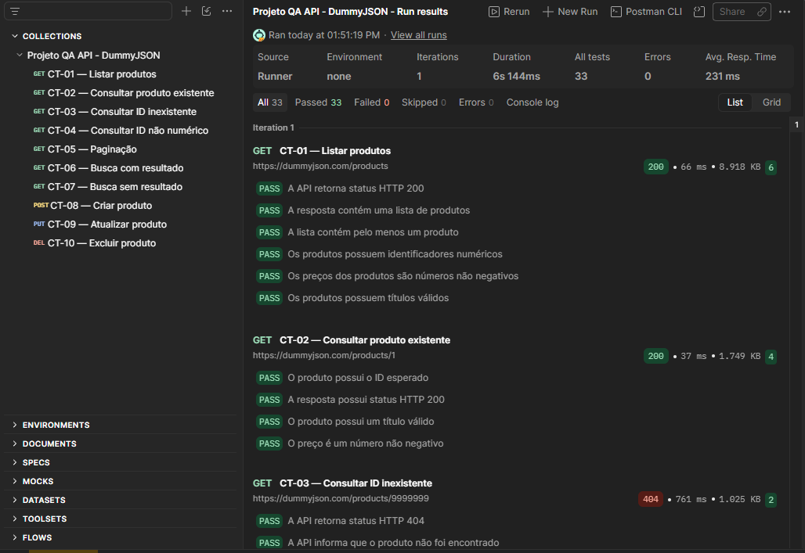
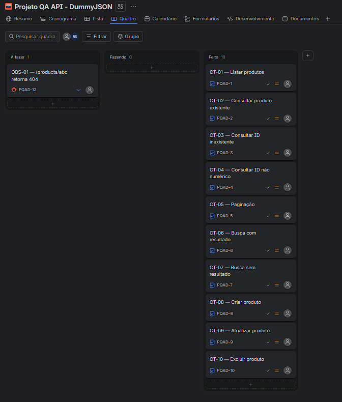

# Projeto de QA — Testes de API (DummyJSON)

> **PT-BR** | [English summary](#english-summary)

Projeto de portfólio para praticar o ciclo básico de QA em uma API pública: planejar casos de teste, executar testes manuais e automatizados, medir desempenho e registrar problemas de forma organizada.

## Objetivo

Exercitar as atividades de um(a) estagiário(a) de QA: entender o comportamento esperado, projetar casos de teste, automatizar verificações, relatar observações com clareza e acompanhar o trabalho em um quadro Kanban.

## Ferramentas

| Ferramenta | Uso neste projeto |
|---|---|
| Postman / Postman CLI | Coleção de testes de API com verificações automatizadas |
| K6 | Teste de carga leve (smoke/load) |
| Jira (Kanban) | Gestão dos casos de teste e registro de observações |
| GitHub | Versionamento e documentação |

API testada: <https://dummyjson.com> (recurso: `products`). É uma API pública de demonstração, então os testes de carga são propositalmente leves.

## Status do projeto

- [x] CT-01 a CT-04: consultas (positivas e negativas) automatizadas no Postman
- [x] CT-05 a CT-10: paginação, busca, criação, atualização e exclusão
- [x] Teste de tempo de resposta incluído nos CT-05 a CT-10 (meta < 1000 ms)
- [x] Script K6 executado e resultado documentado em `k6/README.md` e `docs/evidencias/k6-resumo.json`
- [x] Quadro Kanban no Jira com os casos de teste
- [x] Observação OBS-01 registrada no Jira
- [x] Evidências (prints) adicionadas em `docs/evidencias/`

## Resultados (execução de 27/10/2026)

- 10 casos de teste, com 33 verificações automatizadas aprovadas no Postman (0 erros).
- Teste de carga leve no K6: 5 usuários virtuais por 30 s, 208 requisições, 0% de falhas e p(95) de 471 ms.
- 1 observação registrada no Jira (OBS-01), ainda em aberto.

## Casos de teste

A lista completa está em [docs/casos-de-teste.md](docs/casos-de-teste.md). Detalhamento de exemplo: [CT-03](docs/CT-03-produto-inexistente.md).

## Como reproduzir

**Postman CLI** (a partir da raiz do projeto):

    postman collection run "postman/collections/Projeto QA API - DummyJSON" --no-report-events

**K6** (a partir da raiz do projeto):

    k6 run k6/load-test.js

Detalhes e interpretação dos resultados em [k6/README.md](k6/README.md).

## Gestão no Jira

Como os casos foram organizados no quadro Kanban: [docs/kanban-jira.md](docs/kanban-jira.md).

## Observações e bugs

Registro em [docs/relatorio-de-bugs.md](docs/relatorio-de-bugs.md).

## Evidências

**Execução da coleção no Postman (33 verificações aprovadas):**

**Quadro Kanban no Jira:**

Também em [docs/evidencias/](docs/evidencias/): o card da observação OBS-01 e o resumo do K6 em JSON.

## O que aprendi

- Aprendi a transformar cenários de uso em casos de teste positivos e negativos, definindo o resultado esperado antes de executar.
- Aprendi a validar tanto o status HTTP quanto os campos importantes do JSON, e a automatizar essas verificações no Postman.
- Entendi que uma resposta `404` pode ser válida em um cenário negativo, desde que corresponda ao comportamento esperado para aquele caso.
- Aprendi a interpretar um teste leve de carga no K6 usando falhas, verificações e percentil 95, sem confundir um pico isolado com o limite aplicado ao p95.
- Pratiquei acompanhar os casos e registrar uma observação no Jira, mantendo evidências e resultados documentados.
- Antes deste projeto eu não tinha contato prático com testes de software. Minha maior dificuldade foi aprender a usar o Postman, mas repetindo o processo a cada caso de teste ficou mais natural.

## Próximos passos

- Aprender **Cypress** para testes automatizados de interface (E2E).
- Explorar variáveis de ambiente no Postman (ex.: `baseUrl`).
- Estudar estratégias de teste em Scrum (critérios de aceite e Definition of Done).

## Limites

Projeto de estudo. Cobre validações básicas de resposta HTTP e JSON em um único recurso de uma API de demonstração. Resultados refletem execuções específicas e podem variar se a API mudar ou estiver indisponível.

---

## English summary

Portfolio project practicing the basic QA cycle on a public API (DummyJSON): test case design, automated API checks with Postman, a light load test with K6, and issue tracking on a Jira Kanban board.

- **Scope:** `products` endpoints (list, get by id, pagination, search, create, update, delete), including negative scenarios (non-existent and non-numeric IDs).
- **Run API tests:** `postman collection run "postman/collections/Projeto QA API - DummyJSON" --no-report-events`
- **Run load test:** `k6 run k6/load-test.js` (kept intentionally light because it targets a public demo API).
- **Findings:** logged in [docs/relatorio-de-bugs.md](docs/relatorio-de-bugs.md).
- **Next steps:** learn Cypress for UI test automation.
